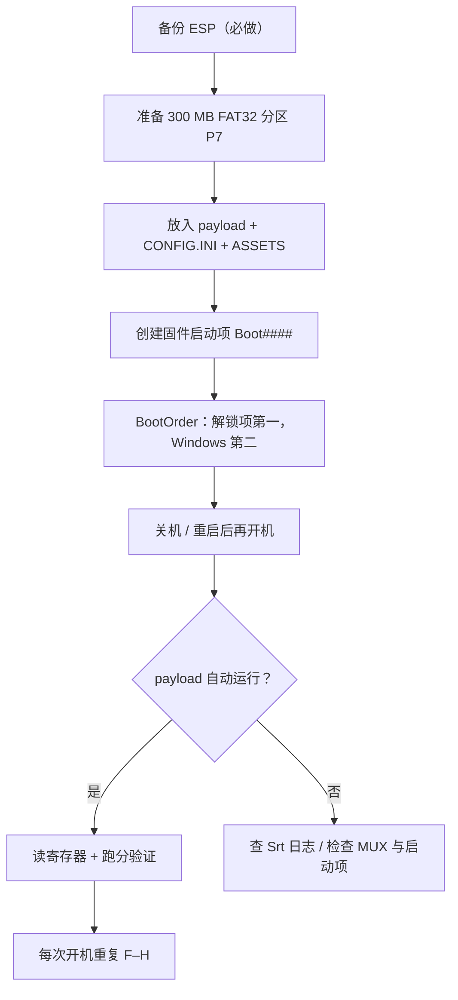

# 笔记本 RTX 4090（AD103）算力解锁方法论

> 一份**方法论**，不是某台机器的傻瓜教程。
> 讲清楚：锁的是什么、什么条件下能解、怎么验证真的解了、出问题怎么退回去。

**实测平台**：RTX 4090 Laptop（AD103，`10de:2757` / 子系统 `1a58:3007`），SM 8.9，76 SM，16 GB GDDR6。

**实测结果**：FP16 / BF16 张量吞吐从出厂锁定的 **≈60 TFLOPS（512 FLOP/SM/cyc）** 提升到 **104–108 TFLOPS（885–928 FLOP/SM/cyc）**，约 **1.75 倍**。

---

## English TL;DR

NVIDIA hard-codes power/rate limits in firmware for mobile AD103, capping FP16/BF16 tensor throughput at **512 FLOP/SM/cyc** (~60 TFLOPS on a 76-SM part). This document describes a UEFI-stage payload that runs **before** Windows boots, maps the GPU's PCI BAR0, and overwrites four registers (`PLM`, `SS0`, `SS1`, effective limit). Measured result on an RTX 4090 Laptop: **104–108 TFLOPS, 885–928 FLOP/SM/cyc**, ~1.75×.

Four hard prerequisites: **MUX / discrete-only mode**, **Secure Boot off**, **ability to create UEFI boot entries**, and a **payload that accepts your Device ID**.

The unlock is **volatile** — it is not a VBIOS flash. It must be re-applied on every cold boot.

---

## 目录

- [0. 风险与免责](#0-风险与免责)
- [1. 原理：到底锁的是什么](#1-原理到底锁的是什么)
- [2. 先判断能不能走这条路](#2-先判断能不能走这条路)
- [3. 实测平台信息](#3-实测平台信息)
- [4. 部署流程](#4-部署流程)
- [5. 验证：怎么确认真的解锁了](#5-验证怎么确认真的解锁了)
- [6. 开机方式兼容性](#6-开机方式兼容性)
- [7. 故障排查](#7-故障排查)
- [8. 还原与卸载](#8-还原与卸载)
- [9. 已知限制与未解问题](#9-已知限制与未解问题)
- [10. 兼容性征集](#10-兼容性征集)
- [附录 A：寄存器判据速查](#附录-a寄存器判据速查)
- [附录 B：文件清单](#附录-b文件清单)
- [附录 C：变更记录](#附录-c变更记录)

---

## 0. 风险与免责

1. **硬件风险**：以超出厂功耗长期运行，会加剧发热、加速元器件老化，极端情况下可能损坏 GPU 或主板供电。
2. **保修**：厂商普遍将固件 / 功耗改动视为改装，保修大概率失效。
3. **稳定性**：可能出现驱动崩溃、花屏、黑屏、无法开机。
4. **合规性**：修改自有硬件在多数司法辖区合法，但可能违反厂商 EULA。自行判断。
5. **无担保**：本文是技术记录。**动手前务必备份 ESP，并确认能还原。**

> 本文所有数字均为**单机实测**，受温度、硅片体质、功耗墙、负载类型影响，不构成对其他机器的性能承诺。

---

## 1. 原理：到底锁的是什么

### 1.1 锁在哪里

NVIDIA 在 VBIOS / 固件里写死了一组寄存器，控制功耗上限与算力发射率比例。移动端 AD103 的出厂设定把 FP16/BF16 张量算力压在 **512 FLOP/SM/cyc**。

以本机为例（76 SM）：

```
512 FLOP/SM/cyc × 76 SM × 1.56 GHz ≈ 60.7 TFLOPS
```

这就是你在任何跑分软件上看到的「4090 笔记本 ≈ 60 TFLOPS」的来源。

### 1.2 改哪四个地方

payload 在 **UEFI 阶段（Windows 启动之前）** 运行，取得 GPU 的 PCI BAR0，直接改写：

| 目标 | 写入值 | 含义 |
|---|---|---|
| `PLM`（power limit） | `0xffffffff` | 解除功耗上限哨兵 |
| `SS0`（selector 0） | `0x88888888` | 解除速率比例锁 |
| `SS1`（selector 1） | `0x8` | 同上，第二组 |
| `effective limit` | 非哨兵值，且 `& 0x07ffffff == 0` | 生效值 |

改写后理论上限约为 **1024 FLOP/SM/cyc**（≈120 TFLOPS）。实测落在 885–928，即达到理论值的 **86–91%**——剩余损耗来自功耗墙、温度、以及非纯发射率瓶颈。

### 1.3 三个必须建立的认知

**① 不驻留。** payload 只在本次开机改一次寄存器，不常驻内存、不写 VBIOS、不改注册表、不动驱动。关机 / 重启 / PIN 复位后状态必然丢失，**每次开机都要重新跑一次**。

**② 不是超频软件。** 它改的是固件级限制，不是驱动里的 offset。所以看不到「频率 +xxx MHz」这种参数，只有「锁定 / 解锁」两种状态。用 MSI Afterburner 之类的工具观察，也看不到功耗墙被抬高——因为 NVML 在移动端读不到可写的 `power.limit`（见 §9）。

**③ 不可逆风险极低，但不是零。** 因为不写任何持久存储，正常路径下最坏结果是「本次开机失败」，强制断电即恢复。真正的风险集中在**引导项操作**那一步（改分区类型、改 BootOrder），那才是唯一可能把机器搞成不能开机的地方。

---

## 2. 先判断能不能走这条路

### 2.1 四个硬前提

| 前提 | 说明 | 不满足的后果 |
|---|---|---|
| **独显直连（MUX）** | BIOS / 厂商软件里切到独显直连 | 混合模式（Optimus）下 dGPU 早期进入 D3cold，payload 访问不到 BAR0 → 失败码 `0x8000000000000006` |
| **Secure Boot 关闭** | PK 不动，payload 无需签名 | 开着 Secure Boot 会拒绝运行未签名 payload |
| **可创建 UEFI 启动项** | 能建 `Boot####` 并调整 `BootOrder` | 无法让 payload 开机自动运行 |
| **payload 支持你的 Device ID** | 公开版 v0.4.18 钉死 `2704` / `1795`，会拒绝 `2757` | 直接判「不支持的设备」，不执行 |

> **怎么判断是否已独显直连**：`display_active=Enabled` **不等于**独显直连。更可靠的信号是**核显出现 `CM_PROB_PHANTOM`**（固件层面已禁用核显）。本机实测：Intel UHD Graphics 状态 `CM_PROB_PHANTOM`、`Present=False`，NVIDIA 状态 `OK`。

> **Secure Boot 的正确处理**：只关 Secure Boot（PK 保持不动）。**绝不要做 Custom Mode / Reset to Setup Mode**——那会临时清空 PK，可能导致无法启动。

### 2.2 三十秒自检

Windows 下（第 4 步需要管理员）：

```powershell
# 1. GPU 身份
nvidia-smi --query-gpu=name,pci.device_id,pci.sub_device_id,vbios_version,power.default_limit,power.max_limit --format=csv

# 2. 是否已独显直连（核显应为 CM_PROB_PHANTOM）
Get-PnpDevice -Class Display | Select-Object FriendlyName, Status, Present, Problem

# 3. SM 数量（用来算 FLOP/SM/cyc）
python -c "import torch;p=torch.cuda.get_device_properties(0);print(p.multi_processor_count)"

# 4. 现有固件启动项（需管理员）
bcdedit /enum firmware
```

第 2 步若核显是 `OK` 且 `Present=True`，说明还在混合模式，先去 BIOS / 厂商控制中心切独显直连，否则后面必然失败。

---

## 3. 实测平台信息

| 项目 | 值 |
|---|---|
| GPU | NVIDIA GeForce RTX 4090 Laptop GPU |
| PCI ID | `10DE:2757`（rev a1） |
| 子系统 ID | `1A58:3007`（Razer） |
| 架构 | AD103，SM 8.9，**76 SM** |
| 显存 | 15.99 GiB GDDR6（非 X） |
| VBIOS | `95.03.2b.40.9f` |
| 驱动 | NVIDIA 617.42（Windows 版本号 `32.0.16.1742`，2026-09-30） |
| 功耗（NVML 读数） | `default_limit = 115 W`，`max_limit = 175 W`，**`power.limit = [N/A]`** |
| 实测稳态功耗 | ≈159.7 W（压测 20 s 后中位数） |
| 显示拓扑 | 核显 `CM_PROB_PHANTOM`（已禁用）→ **独显直连** |
| Secure Boot | 关闭，PK 未改动 |
| 系统 | Windows 11 |
| 系统盘 | NVMe 1907.7 GB，GPT |
| ESP（真） | 分区 2，589.2 MB，FAT32，GUID `f8698fdd-9acc-11f0-826f-70d8235aa2ca` |
| P7（解锁用） | 分区 7，**300 MB**，FAT32，卷标 `GPUUNLOCK`，GUID `9455cdd9-d139-11f1-8cdf-915fc63fbdcb`，偏移 2046573936640 |

---

## 4. 部署流程



### 步骤 0：备份 ESP（铁律，不可跳过）

**在碰任何分区表 / 引导（BCD、`Boot####`、`GptType`）之前，必须先有可恢复的 ESP 备份，并验证备份能还原。**

本机的做法是三个脚本配套：

| 脚本 | 作用 |
|---|---|
| `17-BACKUP-ESP.cmd` | 导出整个 ESP 到 `F:\_EFI_BACKUP\<时间戳>\` |
| `18-RESTORE-ESP.cmd` | 一键还原 |
| `_verify_esp_backup.py` | 只读校验（免管理员） |

本机共留了 6 份备份（2026-10-26 21:32 至 21:58 各一次），外加一份独立的 ESP 救盘包。

> **验收标准**：还原脚本必须在**没出问题之前**就试跑一次。没验证过的备份等于没有备份。

### 步骤 1：识别真正的 ESP

多 ESP 机器上这一步最容易出事：

- ❌ `mountvol X: /S` 会**乱挑**一个 ESP，不可靠。
- ✅ 用 `Get-CimInstance Win32_Volume` 取 `DeviceID`（形如 `\\?\Volume{GUID}\`），GPT 卷 GUID 等于分区 GUID。
- ⚠️ `Win32_Volume.Guid` **永远返回空串** → 必须用正则从 `DeviceID` 里取：

  ```powershell
  [regex]::Match($devId,'Volume\{([0-9a-fA-F\-]{36})\}').Groups[1].Value
  ```

- 挂载：`mountvol X: \\?\Volume{GUID}\`
- 只读替代方案：`Get-Partition -DiskNumber 0 | Select Guid`（免管理员）

### 步骤 2：准备 P7 分区

- 大小：约 300 MB，FAT32，卷标 `GPUUNLOCK`。
- 本机 payload + 素材合计约 84 MB，300 MB 有充足余量。
- 布局：

```
\EFI\GPUUNLOCK\BOOTX64.EFI      ← payload（本机 108,544 B）
\RTX4090-PREP\CONFIG.INI        ← 配置（947 B）
\RTX4090-PREP\ASSETS\*          ← 素材（9 个文件，84.3 MB）
```

> ⚠️ **`CONFIG.INI` 在 `\RTX4090-PREP\` 下，不在分区根目录。** 放错位置 payload 会读不到配置。

> ⚠️ **关于分区类型，两条互斥的经验都真实发生过**：早期把新分区设为 ESP 类型后，Windows 一度出现两个 ESP、引导异常，靠备份恢复；而最终稳定部署里，P7 **确实是** ESP 类型（GUID `c12a7328-f81f-11d2-ba4b-00a0c93ec93b`），且能正常启动。
>
> 结论：**类型本身不是决定因素，决定因素是 `BootOrder` 和 `Boot####` 的 device 指向。** 但改类型那一刻会触发 Windows 重新评估引导，风险窗口就在那里。所以顺序必须是：先备份 → 再改 → 改完立刻核对 `BootOrder` → 不能启动就还原。

### 步骤 3：配置 CONFIG.INI（三种模式）

| 模式 | 行为 | 适合 |
|---|---|---|
| `manual` | 开机时按 `U` / `S` / `Esc` 手动选择 | 调试 |
| `probe` | **只读**探测，不改寄存器、不做 DMA、不做 FLR | 先确认这条路走不走得通 |
| `automatic` | 倒计时后自动解锁并引导 Windows，零按键 | **日常使用（推荐）** |

**强烈建议先用 `probe` 跑一次**。只读模式下最坏结果是白跑一趟，不会碰任何寄存器。

### 步骤 4：创建固件启动项并排序

- 新建 `Boot####`（本机为 `Boot0002`），描述 `GPU Unlock (P7)`。
- `BootOrder` 必须是：**解锁项第一 + Windows Boot Manager 第二**。

```
❌ 绝不能只留解锁项 —— 那样 payload 跑完就停在原地，进不了系统。
```

- 查看：`bcdedit /enum firmware`
  （**不要**用 `bcdedit /enum {fwbootmgr}`，它不打印子条目描述）

### 步骤 5：重启验证

payload 运行后会在 P7 卷写报告：

- `manual` 模式 → `RUNnn`
- `automatic` 模式 → `AUTOnnnn`

> ⚠️ **编号跟着卷走、各自从 0 开始。判断新旧要看文件修改时间（mtime），不要看编号。**
>
> 判断「这次到底跑没跑」的可靠办法：比对 `LastBootUpTime` 与目标卷的可用空间变化（每次会写 `PROM.BIN` 约 1 MB + `REPORT.TXT` 约 0.1 MB）。

---

## 5. 验证：怎么确认真的解锁了

两条独立证据链，**两条都要过**才算解锁成功。

### 5.1 寄存器判据（冷态按位查）

```
plm == 0xffffffff
ss0 == 0x88888888
ss1 == 8
effective 非哨兵值
(effective & 0x07ffffff) == 0
```

关键细节：

- **冷态下 `SS0` 每轮随机**（见过 `0x70005105` / `0x70005115` / `0x70005135`），解锁后**恒为 `0x88888888`** → 所以只能看解锁后的值，不能拿冷态值去比对。
- 哨兵 `0xbadfxxxx` 表示**不可读**，不是故障。
- `FBPA matched=0` 是已知的非致命现象，不影响判定。

### 5.2 跑分判据（这一条才作数）

寄存器改对了不等于算力真的上去了——业界已有反例（见 §9）。**必须用吞吐量证明。**

方法：**持续压 12–20 秒让 GPU 爬到稳态 boost，只统计后半段**，同时高频采样 `clocks.sm`，两者相除得到每周期发射率。

```
FLOP/SM/cyc = TFLOPS × 1e12 / (clock_Hz × SM_count)
```

判据：

| 状态 | FLOP/SM/cyc | 76 SM @1.56 GHz 对应 |
|---|---|---|
| 出厂锁定 | **512** | ≈60 TFLOPS |
| 解锁成功 | **880–937** | 104–108 TFLOPS |

> ⚠️ **短测试会骗人。** 10 次 8192 matmul（约 0.3 秒）时 GPU 还在爬频（780 → 855 → 975 MHz），会得出 54.65 TFLOPS 这种既不是锁定值也不是解锁值的假数。**必须持续压 12 秒以上。**

现成脚本见 [`verify/steady_bench.py`](verify/steady_bench.py)，依赖只有 PyTorch：

```bash
python verify/steady_bench.py
```

### 5.3 本机实测数据

**解锁态（稳态压测，2026-10-28 复测）**

| 项目 | TFLOPS | SM 频率 | 功耗 | 温度 | **FLOP/SM/cyc** |
|---|---|---|---|---|---|
| FP16 N=8192 | 104.95 | 1560 MHz | 159.8 W | 65 °C | **885.2** |
| BF16 N=8192 | 107.15 | 1590 MHz | 159.7 W | 70 °C | **886.7** |
| FP16 N=16384 | 107.85 | 1530 MHz | 159.7 W | 73 °C | **927.5** |

**历史记录（同机，冷启动 `automatic` 模式）**

| 项目 | TFLOPS | FLOP/SM/cyc |
|---|---|---|
| FP16 8192 | 99.08 | 812 |
| BF16 8192 | 100.95 | — |
| FP16 16384 | 103.13 | 870 |

**汇总**

| 状态 | FP16 | BF16 | FLOP/SM/cyc | 相对出厂 |
|---|---|---|---|---|
| 出厂锁定 | ≈60 TFLOPS | ≈60 | 512 | 1.00× |
| 解锁 | 104–108 TFLOPS | 105–107 | 885–928 | **≈1.75×** |

---

## 6. 开机方式兼容性

| 开机方式 | 电源状态 | 结果 |
|---|---|---|
| 普通关机 → 开机 | S4（快速启动开启时为混合关机） | ✅ 105–108 TFLOPS |
| 按 Shift 关机 → 开机 | S5（完整断电） | ✅ |
| Windows「重启」 | — | ✅（报告 `attempted=1`、`FINAL status=0`） |

**本机结论：任意关机 / 重启方式都能解锁。** 原因：本机 MUX 独显在任何开机类型下，EC 都会切断 dGPU 供电，使「重启」约等于冷启动，payload 每次都能跑通。

> ⚠️ **不要套用台式机经验。** 台式机上「重启不断电」，payload 可能不重跑。笔记本 MUX 机型往往每次都是真冷启动。**以你自己机器的实测报告为准，不要以本文为准。**

> 补充：早期曾观测到一次热重启丢解锁（`CHECK stage=target status=0x8000000000000003`、`attempted=0`、`clean=1`，payload 干净退回锁定态，PCI `config[00]=275710de 00100000`，Memory Space Enable 掉了、BAR0 不可访问）。后续 20+ 次复测再未复现，判定为早期供电异常个例。

---

## 7. 故障排查

### 7.1 错误码对照

| 现象 / 错误码 | 根因 | 处理 |
|---|---|---|
| `0x8000000000000006` | dGPU 在 D3cold，BAR0 不可访问 | 检查是否**真的**切到独显直连（MUX） |
| `0x8000000000000003`（EFI_UNSUPPORTED）+ `attempted=0` | payload 干净退回锁定态 | 确认那次「重启」是否真断电；看报告 `clean=1` |
| 引导损坏 / 出现两个 ESP | 新分区误设成 ESP 类型 | 用 ESP 备份还原；核对 `BootOrder` |
| `mountvol /S` 挂错盘 | 多 ESP 机器乱挑 | 用 `Win32_Volume` 按 GUID 识别 |
| payload 读了配置但行为不对 | `CONFIG.INI` 放错位置 | 必须在 `\RTX4090-PREP\` 下，不在分区根 |

### 7.2 Windows / PowerShell 侧的坑（这些比 GPU 本身更容易卡住你）

| 现象 | 根因 | 处理 |
|---|---|---|
| 文件明明在，脚本报「找不到项」 | PS 5.1 对 Hidden+System 不加 `-Force` 看不见，但 `Test-Path` 返回 True | 用 .NET：`[IO.File]::Copy`、`[IO.File]::Open`+SHA256、`[IO.FileInfo]::Length` |
| 明明成功却报失败 | `$LASTEXITCODE` 只被子脚本显式 `exit N` / 外部 exe 赋值；自然结束保持 `$null`，`$null -ne 0` 判为 True | 被编排脚本的成功路径显式 `exit 0`；调用方用产物 `Test-Path` 兜底 |
| `Get-PartitionSupportedSize` / `Get-FirmwareEnvironmentVariableEx` / `bcdedit` 报拒绝访问 | 需管理员 | 提权后执行 |
| `Win32_Volume.Guid` 永远空串 | 已知行为 | 从 `DeviceID` 正则取 GUID |
| 排查启动失败 | — | 看 `C:\Windows\System32\LogFiles\Srt\` |

---

## 8. 还原与卸载

三种方式，从轻到重：

1. **什么都不做。** payload 本就不驻留，卸载后重新开机即回到锁定态，无需「复位」。
2. **删除 payload 与固件启动项。** 用清理脚本（**删前先归档**），并从 `BootOrder` 里移除该项。
3. **整盘还原。** 直接用步骤 0 的 ESP 备份一键还原。

> 注意：只删 `\EFI\GPUUNLOCK\BOOTX64.EFI` 而不清 `BootOrder`，会得到一个指向空路径的启动项，开机会报错或卡在固件界面。**两者要一起处理。**

---

## 9. 已知限制与未解问题

诚实列出，避免读者踩同样的坑：

1. **`power.limit` 在移动端读不到。** NVML 返回 `[N/A]`，`default_limit` 是 115 W，`max_limit` 175 W。所以**无法用数值直接证明功耗墙被抬高**，只能靠吞吐量间接证明。
2. **寄存器改对 ≠ 算力提升。** 已有一例 RTX 4090 Laptop（CLEVO 子系统 `1558:3702`、驱动 580.178.04、CachyOS 内核）报告：payload 完成、权限寄存器与 selector 全部回读匹配、日志输出 `gpu_unlock: unlocked`、无 `NVRM: Xid`，但配对 CUDA 跑分**吞吐无变化**。该次结论为 inconclusive（且 stock / unlocked 用了不同内核，未做严格配对）。
   → **这正说明为什么 §5.2 的跑分验证不可省。**
3. **fp8 / int8 的解锁吞吐无法用常见 PyTorch 构建直接测。** 实测某嵌入式 torch 2.13.0+cu130：`torch._int_mm` 回退到标量参考实现（约 1 TOPS，非张量核）；fp8 `_scaled_mm` 报 `CUBLAS_STATUS_NOT_SUPPORTED`；plain `@` 报 `NotImplementedError`。要测 int8/fp8 需 CUTLASS / TensorRT 或另装支持 int8/fp8 张量核的 torch。
4. **`nvfp4` / `mxfp8` 在 SM 8.9 上无硬件加速**（要求 major ≥ 10），解锁也改变不了这一点。
5. **需要每次开机重跑。** 这是设计使然，不是缺陷。

---

## 10. 兼容性征集

欢迎提交你机器上的实测数据，一起把兼容性表补全。

需要的字段：

```
GPU 型号：
PCI ID / 子系统 ID：
VBIOS：
驱动版本：
内核 / 系统：
MUX 状态（核显是否 CM_PROB_PHANTOM）：
payload 版本 / 来源：
报告关键行（attempted / FINAL status / SS0 / SS1 / PLM）：
跑分（TFLOPS + FLOP/SM/cyc，注明压测时长）：
```

> 提交前请**脱敏**：不要包含个人路径、序列号、机器名。

---

## 附录 A：寄存器判据速查

```
PLM       : 0xffffffff                        （出厂为非 0xffffffff）
SS0       : 0x88888888                        （冷态随机，仅解锁后恒定）
SS1       : 0x8                               （冷态通常 0x3）
effective : 非哨兵，且 (effective & 0x07ffffff) == 0
哨兵      : 0xbadfxxxx = 不可读，不是故障
FBPA      : matched=0 已知非致命
```

---

## 附录 B：文件清单

本文方法对应的工具（按功能命名，便于自行实现）：

| 工具 | 功能 |
|---|---|
| `BACKUP-ESP` / `RESTORE-ESP` / `VERIFY-ESP` | ESP 备份、还原、只读校验 |
| `AUTO-BOOT` | 创建 / 调整 / 还原固件启动项（full / config / revert / list） |
| `GET-REPORT` | 收集 `RUN*` / `AUTO*` 报告 |
| `CLEANUP` | 删除 payload 与固件项（删前归档） |
| [`verify/steady_bench.py`](verify/steady_bench.py) | 稳态吞吐验证（本文 §5.2） |

---

## 附录 C：变更记录

| 日期 | 变更 |
|---|---|
| 2026-10-27 | 初版方法论（12 节） |
| 2026-10-28 | 补充实测平台完整清单、双 ESP 的实际情况与风险说明、`power.limit=[N/A]` 限制、寄存器改对但吞吐无变化的反例、int8/fp8 无法测的限制；加入 `verify/steady_bench.py`；新增英文摘要与兼容性征集模板 |

---

## 致谢

- 上游项目：**TOTORONG/AD103_win_unlocker**（托管在 Hugging Face，不在 GitHub；请在 HF 上搜索该仓库名获取）。
- 「不用 U 盘、payload 与 Windows 引导同卷」的机制来自 **Goldlionren/gpu-unlock-4080s**（`src/app.c`，`internal_volume=1`）。注意该仓库是单板卡项目，入口硬编码 `10de:2702 / 19da:4702`（4080 SUPER），**不能直接用于 4090 Laptop**，只能借机制。
- 本文基于 RTX 4090 Laptop（`10de:2757`）实测整理，方法与数据仅代表该平台。
